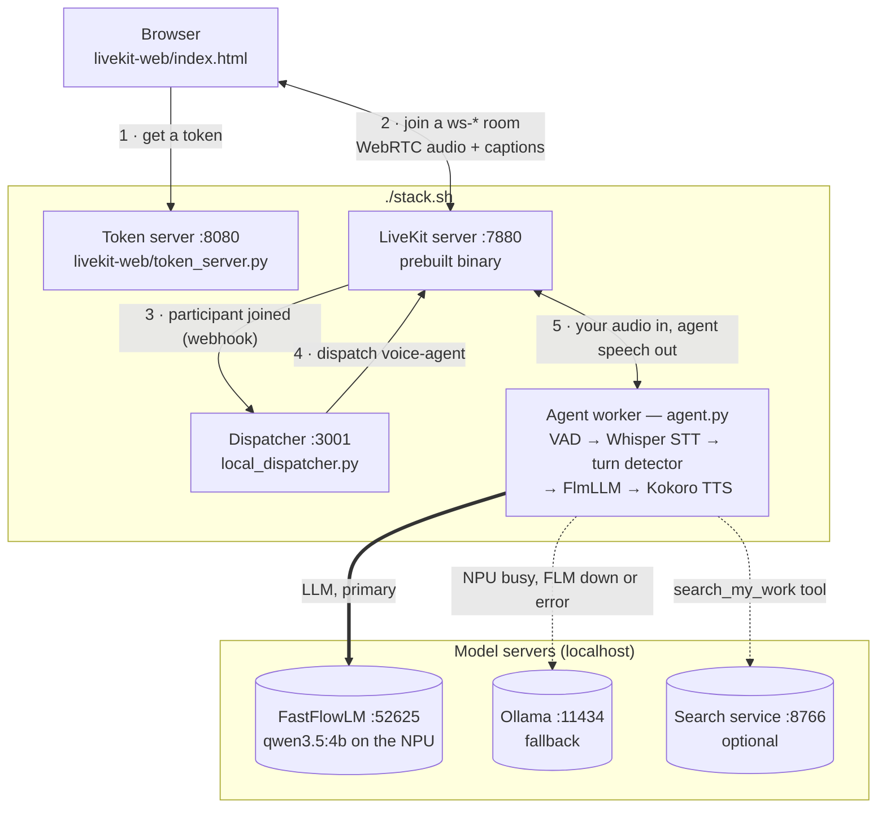
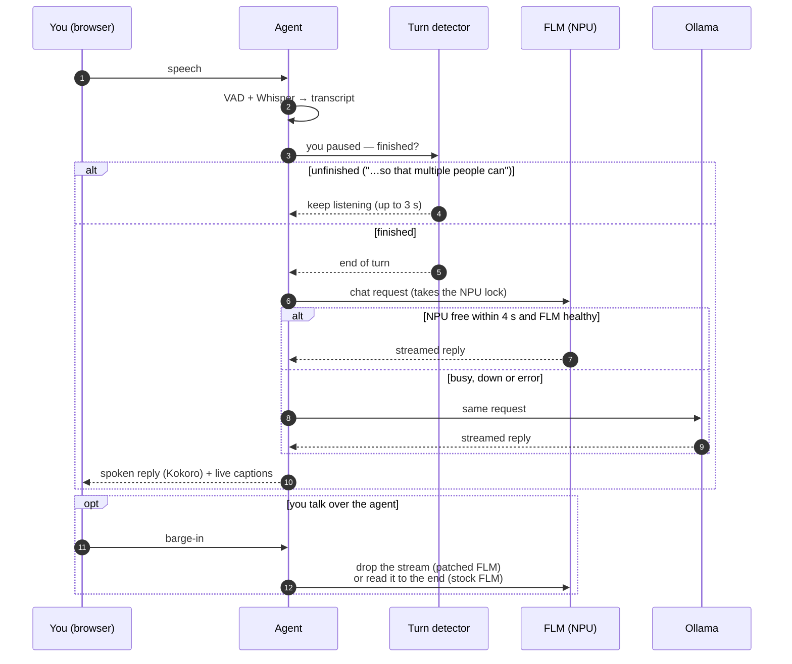
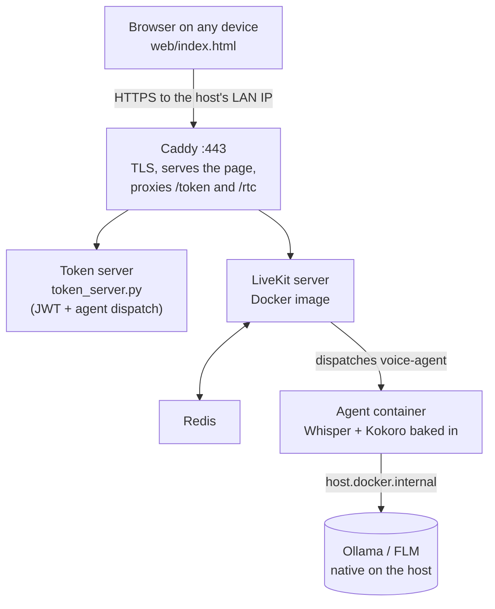

# Personal Voice Assistant

A fully local, real-time voice assistant. Speech-to-text, the language model,
text-to-speech, end-of-turn detection and even the real-time media server all run
on your own machine — no cloud APIs.

- **Talk naturally from a browser**: no push-to-talk; interrupt the assistant any
  time; it waits while you're mid-thought instead of answering half a sentence.
- **LLM on the AMD NPU** via [FastFlowLM](https://github.com/ROCm/FastFlowLM),
  with an automatic [Ollama](https://ollama.com) fallback.
- **Self-hosted LiveKit**: the server binary, a webhook dispatcher and a web
  client, brought up by one script (`./stack.sh`).
- **Swappable providers**: each stage (STT / LLM / TTS) can point at a local
  in-process model, a local Docker service, or any OpenAI-compatible endpoint.

## Contents

[How it works](#how-it-works) ·
[Requirements](#requirements) ·
[Quick start](#quick-start) ·
[Ways to run](#ways-to-run) ·
[The web client](#the-web-client) ·
[The LLM on the NPU](#the-llm-on-the-npu-fastflowlm) ·
[Conversation behaviour](#conversation-behaviour) ·
[Knowledge base](#knowledge-base-optional) ·
[Configuration](#configuration) ·
[Security & privacy](#security--privacy) ·
[Operating the stack](#operating-the-stack) ·
[Testing](#testing) ·
[Troubleshooting](#troubleshooting) ·
[Project layout](#project-layout) ·
[Third-party components](#third-party-components) ·
[License](#license)

## How it works

The self-hosted stack (`./stack.sh`, option 4 below):



One conversational turn, including the two things that make a voice agent hard —
deciding when you've finished, and what to do when you interrupt:



| Stage | Engine | Notes |
|-------|--------|-------|
| VAD | Silero (bundled in `livekit-plugins-silero`) | detects speech start/stop |
| STT | [faster-whisper](https://github.com/SYSTRAN/faster-whisper) | in-process, `base` model, int8 on CPU |
| End of turn | [LiveKit turn detector](https://github.com/livekit/agents/tree/main/livekit-plugins/livekit-plugins-turn-detector) | multilingual model, local ONNX on CPU (~25–40 ms per check) |
| LLM | [FastFlowLM](https://github.com/ROCm/FastFlowLM) · `qwen3.5:4b` on the NPU; [Ollama](https://ollama.com) fallback | ~2.5 s to first word on FLM; Ollama on CPU ~7 s |
| TTS | [Kokoro](https://github.com/thewh1teagle/kokoro-onnx) | in-process ONNX, 24 kHz, voice `af_heart` |
| Orchestration | [LiveKit Agents](https://github.com/livekit/agents) 1.5 | console **or** room mode |
| Media server | [LiveKit server](https://github.com/livekit/livekit) 1.9.9 | vendored binary (option 4) or Docker image (option 3) |

## Requirements

- **Linux** for the full stack (developed on Ubuntu 26.04). The Docker setup
  (option 3) also runs on macOS/Windows hosts.
- **Python 3.12+** (developed on 3.14; the Docker images use 3.12) with a venv —
  `./start.sh --install` creates `.venv` and installs `requirements.txt`.
- **`libportaudio2`** for console mode's mic/speakers (`start.sh --install` installs it).
- **Ollama** with `qwen3.5:4b` pulled — the fallback LLM, and required by `start.sh`.
- **Optional — an AMD Ryzen AI (XDNA2) NPU + [FastFlowLM](https://github.com/ROCm/FastFlowLM)**
  for the fast path. Without it nothing breaks: every turn falls back to Ollama,
  just slower to first word.
- **Optional — Docker** for options 2 and 3, and to build the patched FLM package.
- About **1 GB of RAM per call** for the agent's in-process models (Whisper,
  Kokoro, VAD, turn detector), plus the LLM itself (`qwen3.5:4b` ≈ 3 GB in Ollama).

Model files download on first use: Whisper and Kokoro weights, Silero VAD and the
turn detector (~500 MB, via `python agent.py download-files`, which `stack.sh` and
`start.sh --install` run for you).

## Quick start

The recommended path is the self-hosted stack:

```bash
./start.sh --install            # once: venv, Python deps, model files, libportaudio2
ollama serve                    # in another terminal; then: ollama pull qwen3.5:4b
./stack.sh                      # starts FLM (if installed), LiveKit, dispatcher, web, agent
```

Open **http://localhost:8080** and click **Start talking**. `Ctrl-C` stops the stack.

## Ways to run

### 1. Native console (single machine, local mic/speakers)
Fastest path on the host itself — everything in-process, no LiveKit server or browser.

```bash
ollama serve                 # in another terminal; pull qwen3.5:4b once
./start.sh --install         # first run: deps + model files + libportaudio2
./start.sh console           # talk via your mic/speakers (the default mode)
./start.sh dev               # or: run as a LiveKit worker in development mode
./start.sh start             # or: run as a LiveKit worker in production mode
```

`start.sh` refuses to start unless Ollama is running (it doesn't check that the
model is pulled, or FLM). The agent itself uses `LLM_PROVIDER` (FLM by default,
falling back to Ollama).

### 2. STT + TTS in Docker, agent native (one-click experiment)
Runs Whisper and Kokoro as containerized OpenAI-compatible providers while the
agent and Ollama stay native — heavy deps/models live in Docker, but you can edit
and re-run agent code instantly. No LiveKit/browser involved.

```bash
OLLAMA_HOST=0.0.0.0 ollama serve     # native, in another terminal
./experiment.sh                      # builds STT/TTS containers, then talk via mic
./experiment.sh --agent-only         # skip Docker; relaunch agent against running containers
./experiment.sh --down               # stop the STT/TTS containers when done
```

`experiment.sh` brings up `docker-compose.dev.yml` (`stt` on :8001, `tts` on
:8002 — `stt_server.py` / `tts_server.py`, built from `Dockerfile.services`), waits
for health, then runs the agent in console mode with `STT_PROVIDER=openai` /
`TTS_PROVIDER=openai` pointed at them. `--agent-only` is handy for fast iteration
and when your shell lacks docker-group access but the containers are already up.
Swap either stage to the cloud later by changing its `*_BASE_URL` / `*_API_KEY`.

### 3. Docker LAN ecosystem (talk from any device's browser)
Self-hosts the LiveKit stack in Docker on one host; phones/laptops on the same
network connect through the browser, which owns the mic (room mode).



#### Prerequisites
- **Docker + Docker Compose** on the host (Docker Desktop on macOS/Windows).
- **Ollama running natively**, reachable from containers:
  ```bash
  OLLAMA_HOST=0.0.0.0 ollama serve      # must bind 0.0.0.0, not just 127.0.0.1
  ollama pull qwen3.5:4b
  ```
  The container also tries FLM at `host.docker.internal:52625`; FLM listens on
  localhost only, so in this mode every turn normally uses Ollama.
- A copy of the config: `cp .env.example .env`, then set **`LIVEKIT_NODE_IP`** and
  the host in **`LIVEKIT_WS_PUBLIC`** to this machine's LAN IP
  (`hostname -I` / `ipconfig getifaddr en0` / `ipconfig`).
- Open the host firewall for `443/tcp`, `7881/tcp`, and `50000-50100/udp`.

#### Run
```bash
docker compose build
docker compose up
```

Then from any device on the network open **`https://<LAN-IP>`**, accept the
self-signed certificate warning once, pick a room, and click **Connect & talk**.

> **Why HTTPS / the cert warning?** Browsers only allow microphone access on a
> secure origin. Caddy serves the stack over HTTPS with a self-signed (internal
> CA) certificate, so each device shows a one-time "not private" warning you can
> safely accept on your own LAN. Media itself (WebRTC) is always encrypted.

Option 3 uses its own simpler client (`web/index.html`) and **token-embedded
dispatch**: the root `token_server.py` writes the agent dispatch into the JWT, so
no dispatcher service is needed. Its LiveKit config is the root `livekit.yaml`
(with Redis); the images are built from `Dockerfile.agent` (models baked in).

### 4. Self-hosted LiveKit binary stack (no Docker image, webhook dispatch)
Runs the actual LiveKit components vendored under `livekit-*/`: the server runs
from the **prebuilt binary** (not the Docker image or LiveKit Cloud), and a
**webhook dispatcher** dispatches the agent instead of the token embedding it.

```bash
ollama serve                   # native, in another terminal; pull qwen3.5:4b once (fallback LLM)
./stack.sh                     # FLM (if needed) + server + dispatcher + web + agent (Ctrl-C stops all)
./stack.sh --monitor           # same, plus the live resource monitor
./stack.sh --node-ip <LAN-IP>  # advertise a LAN IP so other devices can reach the media
./stack.sh --down              # stop anything a previous run left running
```

Then open **`http://localhost:8080`** and click **Start talking**. The flow is the
first diagram in [How it works](#how-it-works).

What `stack.sh` does for you:

- **Credentials** live in `stack.env` (gitignored; template `stack.env.example`).
  The first run generates a random key/secret. No committed file holds a secret:
  the server gets it via the `LIVEKIT_KEYS` env var, and `stack.sh` renders
  `livekit-server/livekit.runtime.yaml` (base config + webhook section) at launch.
- **Config override**: it exports the local key/URL, ports and providers, which
  **override** each component's `.env` and the repo-root `.env` for the stack's
  lifetime — nothing on disk is edited.
- **FastFlowLM**: if installed but not serving, it starts it as the `flm-npu` user
  service and reports which FLM package is installed. It **never stops FLM** on
  teardown — other apps may share it (stop it with `systemctl --user stop flm-npu`).
- **First run**: downloads the end-of-turn model files if they're missing.
- **Teardown**: every component runs in its own process group (recorded in
  `logs/stack.pgids`), so `Ctrl-C`, `SIGTERM` and `--down` stop everything,
  including the agent's child processes.
- **Single node, no Redis**; recording/egress stays off unless you set the
  dispatcher's `EGRESS_*` variables.

To run the dispatcher or web server on their own, copy their `.env.example` to
`.env` and start `livekit-dispatcher/local_dispatcher.py` /
`livekit-web/token_server.py`. `livekit-dispatcher/get_token.py` mints a join token
for any other LiveKit client (`--room`, `--identity`, `--ttl`).

> Option 4 is a different design from option 3 (Docker image + Caddy TLS +
> token-embedded dispatch vs. local binary + webhook dispatcher). Don't run both on
> `:7880`/`:8080` at once.

## The web client

`livekit-web/index.html` (option 4) is a single page with no build step:

- **One glowing orb** that follows the agent's real state (published by LiveKit
  Agents as the `lk.agent.state` attribute): cyan while listening, violet while
  thinking, bright cyan swelling with the voice while speaking.
- **Live captions** of the latest line, and an optional **transcript** (`T`).
- **Mute** with a live level meter of your own mic (`M`), a call timer, and **End**.
- A **pill showing which LLM answered** the last turn (`FLM · NPU` or
  `Ollama · fallback`).
- Your name (remembered between visits) and, under *More options*, language,
  mobile number, room and identity — passed to the agent as caller details.
- Clear messages for a blocked mic, an unreachable stack, or no agent joining
  within 20 s. Light/dark theme, works at phone width.

The LiveKit browser client is **vendored** in `livekit-web/static/` and served by
the token server, so the page works offline. It's pinned to **2.16.1**: every
release from 2.17 first probes a `/rtc/v1` signalling path that the bundled
livekit-server 1.9.9 doesn't serve (a 404 and a retry on each connect).

> Browsers only grant the microphone on a secure origin. `http://localhost:8080`
> counts as one, so same-machine use just works; other devices on the LAN need
> HTTPS in front (e.g. the `Caddyfile` from option 3).

## The LLM on the NPU (FastFlowLM)

`LLM_PROVIDER=flm` (the default) talks to FastFlowLM's OpenAI-format endpoint
(`llm_flm.py`). What it handles that a plain OpenAI client wouldn't:

- **Tools only work on `/v1/chat/completions`.** FLM's Ollama-format `/api/chat`
  silently drops the `tools` array, so the Ollama client can't be reused for FLM.
- **One request on the NPU at a time,** across all call processes (an `flock` on
  `$XDG_RUNTIME_DIR/flm-npu.lock`). If the NPU stays busy longer than
  `FLM_LOCK_WAIT`, the turn goes to Ollama instead of queueing.
- **Falls back to Ollama** when FLM is unreachable, returns an error (including
  FLM's in-band HTTP-200 error bodies), or produces nothing in time. A failure
  *after* FLM has started speaking isn't retried, so speech is never repeated.
- **The greeting:** FLM's chat template rejects a conversation with no user
  message, which is exactly the opening greeting; the agent sends those
  instructions as the user turn.
- **Interrupted answers.** When you talk over the agent, its unfinished answer is
  abandoned. Dropping the HTTP stream frees the NPU at once — but stock
  `flm serve` leaks a connection slot every time a client drops a stream
  ([ROCm/FastFlowLM#680](https://github.com/ROCm/FastFlowLM/issues/680)), and after
  a few (`-s 4`) refuses every connection until restarted. So with stock FLM the
  agent reads abandoned answers to the end (safe, but the next turn waits). With
  the patched package from [`tools/flm-slotfix/`](tools/flm-slotfix/) it drops the
  stream and the NPU is free within milliseconds. The agent detects the
  installed package by itself (`FLM_ABORT_ON_CANCEL=auto`).

Build and install the patched FLM — it rebuilds an official release with the
community fix, inside FLM's own build container (see
[`tools/flm-slotfix/README.md`](tools/flm-slotfix/README.md)):

```bash
tools/flm-slotfix/build-deb.sh v1.0.10          # ~6 min; needs docker + git only
systemctl --user stop flm-npu                   # let FLM go idle first
sudo dpkg -i tools/flm-slotfix/dist/fastflowlm_1.0.10+slotfix1_amd64.deb
sudo apt-mark hold fastflowlm                   # so a stock package can't replace it
```

## Conversation behaviour

- **Turn-taking.** After a pause, LiveKit's local end-of-turn model scores the
  transcript: an unfinished phrase ("…so that multiple people can") keeps the
  agent listening for up to 3 s, while a finished question gets a reply after the
  usual short pause. A pause after a sentence that is complete on its own still
  ends the turn — the interruption handling above covers that case.
- **No preemptive generation with FLM.** LiveKit can start an answer before the
  turn is confirmed and discard it if you keep talking; on a one-request-at-a-time
  NPU a discarded answer would delay the real one, so it's off when the LLM is FLM.
- **Interruptions.** Talk over the agent any time; it stops speaking and listens.
- **Greeting.** The agent greets you by name as soon as it joins.
- **Caller details.** Name, mobile number and language from the web client ride
  in the token's participant metadata → the dispatcher → the job metadata, and
  are prepended to the system prompt.
- **Silence.** After 30 s in which neither side speaks, the agent checks in once
  and then waits.
- **Persona.** `prompts/system_prompt.md`: a "technology demonstrator" that can
  explain its own architecture, keeps replies to two or three sentences, never
  invents facts, and states only the architecture facts it's given.

## Knowledge base (optional)

The agent has one tool, `search_my_work`, which queries a local search service
(`SEARCH_URL`, default `http://127.0.0.1:8766/search`) over your own notes and
summarises the results in its own words. **Nothing in this repo starts that
service**; when it isn't running, the agent says it can't reach your notes and
everything else works normally. Tuning: `SEARCH_MODE`, `SEARCH_TOP_K`,
`SEARCH_CHUNK_CHARS`, `SEARCH_TIMEOUT`.

## Configuration

Settings come from the repo-root `.env` (template: `.env.example`). `./stack.sh`
keeps its LiveKit credentials in `stack.env` and exports its own values over
`.env` for the stack's lifetime. The dispatcher and web server read their own
`.env` only when run standalone.

**Providers**

| Variable | Default | Purpose |
|---|---|---|
| `STT_PROVIDER` | `local` | `local` (in-process Whisper) or `openai` (any OpenAI-compatible STT) |
| `LLM_PROVIDER` | `flm` | `flm` (NPU, Ollama fallback), `ollama`, or `openai` |
| `TTS_PROVIDER` | `local` | `local` (in-process Kokoro) or `openai` |

**LLM**

| Variable | Default | Purpose |
|---|---|---|
| `FLM_BASE_URL` / `FLM_MODEL` | `http://localhost:52625` / `qwen3.5:4b` | FastFlowLM server and model |
| `FLM_MAX_TOKENS` | `400` | Cap on one reply |
| `FLM_LOCK_WAIT` | `4` | Seconds to wait for a busy NPU before falling back |
| `FLM_ABORT_ON_CANCEL` | `auto` | Drop interrupted answers: `auto` (only on a `+slotfix` FLM), `1`, or `0` |
| `OLLAMA_BASE_URL` / `OLLAMA_MODEL` | `http://localhost:11434` / `qwen3.5:4b` | Fallback LLM (from containers: `host.docker.internal`) |
| `LLM_BASE_URL` / `LLM_MODEL` / `LLM_API_KEY` | OpenAI / `gpt-4o-mini` / – | Used when `LLM_PROVIDER=openai` |

**Speech**

| Variable | Default | Purpose |
|---|---|---|
| `WHISPER_MODEL` | `base` | Whisper size: `tiny`, `base`, `small`, `medium`, `large-v3` |
| `WHISPER_DEVICE` / `WHISPER_COMPUTE_TYPE` | `cpu` / `int8` | Where and how Whisper runs |
| `WHISPER_BEAM_SIZE` | `5` | Beam size (Docker STT server) |
| `TTS_VOICE` | `af_heart` | Kokoro voice (e.g. `af_sky`, `bm_lewis`) |
| `TTS_LANG` | `en-us` | Kokoro language (Docker TTS server) |
| `KOKORO_CACHE` | `~/.cache/kokoro-onnx` | Kokoro model folder (Docker TTS server) |
| `STT_BASE_URL` / `STT_MODEL` / `STT_API_KEY` | `http://localhost:8001/v1` / `whisper` / `local` | Used when `STT_PROVIDER=openai` |
| `TTS_BASE_URL` / `TTS_MODEL` / `TTS_API_KEY` | `http://localhost:8002/v1` / `tts-1` / `local` | Used when `TTS_PROVIDER=openai` |
| `STT_PORT` / `TTS_PORT` | `8001` / `8002` | Ports of the Docker STT/TTS servers |

**LiveKit, dispatch and web**

| Variable | Default | Purpose |
|---|---|---|
| `LIVEKIT_API_KEY` / `LIVEKIT_API_SECRET` | – | Shared credentials (`stack.sh`: in `stack.env`, auto-generated) |
| `LIVEKIT_URL` | `ws://localhost:7880` | Where the agent and dispatcher reach the server |
| `LIVEKIT_WS_URL` | `ws://localhost:7880` | Where the **browser** reaches the server (option 4) |
| `LIVEKIT_WS_PUBLIC` | `wss://localhost` | Where the browser reaches the server through Caddy (option 3) |
| `LIVEKIT_NODE_IP` | – | Host LAN IP advertised for WebRTC media (option 3) |
| `DISPATCH_AGENT_NAME` / `LIVEKIT_AGENT_NAME` | `voice-agent` | Agent to dispatch (option 4 dispatcher / option 3 token server) |
| `PORT` | `3001` | Dispatcher port (LiveKit posts webhooks here) |
| `DISPATCHER_HOST` | `127.0.0.1` | Dispatcher listen address (only the local LiveKit server needs it) |
| `WEB_PORT` / `TOKEN_PORT` | `8080` | Web client + token server (option 4) / token server (option 3) |
| `LOG_LEVEL` | `DEBUG` | Dispatcher log level |
| `EGRESS_*` | unset | Dispatcher recording (`EGRESS_AZURE_*`, `EGRESS_FILEPATH`, `EGRESS_LOCAL_DIR`); off unless set |

**Knowledge base**: `SEARCH_URL`, `SEARCH_MODE` (`vector`), `SEARCH_TOP_K` (`4`),
`SEARCH_CHUNK_CHARS` (`600`), `SEARCH_TIMEOUT` (`10` s).

## Security & privacy

- **Nothing leaves the machine during a conversation.** Network access is needed
  only to download models on first use, and FastFlowLM checks for updates when it
  starts.
- **No secrets in git.** LiveKit credentials live in gitignored `stack.env` /
  `.env` files; the server gets its secret through an environment variable.
- **Conversation text is stored locally** in two places: transcripts in
  `logs/agent.log` (gitignored), and FastFlowLM's replies in the systemd journal
  (`journalctl --user -u flm-npu`).
- **Webhooks are verified.** The dispatcher listens on localhost only
  (`DISPATCHER_HOST`, default `127.0.0.1`) and rejects any webhook without a valid
  LiveKit signature (HTTP 401), so nothing else can trigger agent dispatches or
  room teardowns.
- **LAN exposure (option 4).** The web/token server (`:8080`) and LiveKit
  (`:7880`, `:7881`) listen on all interfaces, and the token server has no
  authentication — anyone who can reach it can start a call. Use it on a trusted
  network, or firewall `:8080`. FLM, Ollama and the dispatcher listen on
  localhost only.

## Operating the stack

**Logs** (`logs/`, gitignored): `livekit-server.log`, `dispatcher.log`, `web.log`,
`agent.log`, and the run output you redirect. FastFlowLM logs to the journal:
`journalctl --user -u flm-npu -f`.

**Resource monitor**: `./stack.sh --monitor`, or standalone:

```bash
cd livekit-monitor
../.venv/bin/python monitor.py                  # live table, refreshes every 2 s
../.venv/bin/python monitor.py --interval 1     # refresh every second
../.venv/bin/python monitor.py --once           # one snapshot
../.venv/bin/python monitor.py --csv usage.csv  # also append samples to a CSV
```

**Ports**

| Port | Service | Used by |
|---|---|---|
| 8080 | Web client + token server | option 4 (option 3: token server behind Caddy) |
| 7880 | LiveKit signalling (HTTP/WebSocket) | options 3, 4 |
| 7881/tcp, 50000–50100/udp | LiveKit WebRTC media | options 3, 4 |
| 3001 | Webhook dispatcher | option 4 |
| 443 | Caddy (TLS) | option 3 |
| 52625 | FastFlowLM | LLM (primary) |
| 11434 | Ollama | LLM (fallback) |
| 8001 / 8002 | STT / TTS servers | option 2 |
| 8766 | Knowledge-base search | optional |

## Testing

```bash
python smoke_test.py    # headless: Ollama LLM, Kokoro TTS, Whisper STT, and a TTS→STT round trip
```

The smoke test exercises the Ollama path, not FLM. For the full stack, run
`./stack.sh`, open the web client and talk; the pill shows which LLM answered, and
`logs/agent.log` records each turn (`FLM first token after …`, fallbacks and why).

## Troubleshooting

| Symptom | Likely cause / fix |
|---|---|
| "The assistant hasn't joined yet" | Agent or dispatcher not running — check `logs/agent.log` and `logs/dispatcher.log`. Rooms must start with `ws-` to be dispatched. |
| Microphone blocked | Open the page via `http://localhost:8080`, or put HTTPS in front for other devices. |
| Pill shows `Ollama · fallback` | FLM isn't serving (`systemctl --user status flm-npu`), the NPU was busy, or FLM errored — `logs/agent.log` says which (`FLM unavailable (…)`). |
| FLM refuses connections; journal shows `Connection limit reached` | Stock FLM's slot leak — `systemctl --user restart flm-npu`, and install the `tools/flm-slotfix` package. |
| `start.sh`: "Ollama is not running" | Run `ollama serve` and `ollama pull qwen3.5:4b`. |
| Worker errors about `model_q8.onnx` | End-of-turn model files missing — `python agent.py download-files`. |
| Ports already in use | A previous run is still up — `./stack.sh --down`. |
| "I couldn't reach your knowledge base" | The optional search service isn't running — expected unless you've set it up. |

## Project layout

```
agent.py                 LiveKit entrypoint (console + room mode): greeting, caller details
session.py               Provider factory + pipeline wiring (VAD/STT/LLM/TTS), turn handling, silence watcher
llm_flm.py               FLM (NPU) LLM: /v1 + tools, cross-process NPU lock, drain/drop on interrupt, Ollama fallback
llm_ollama.py            Ollama LLM via /api/chat (think off)
stt_whisper.py           In-process faster-whisper STT plugin (provider: local)
tts_kokoro.py            In-process Kokoro TTS plugin (provider: local)
stt_server.py            OpenAI-compatible Whisper server (provider: openai/docker)
tts_server.py            OpenAI-compatible Kokoro server (provider: openai/docker)
tools.py                 Function tools (search_my_work: local search over your notes)
prompts/system_prompt.md The agent's persona and the facts it may state about itself
smoke_test.py            Headless pipeline check
requirements.txt         Agent dependencies
requirements-services.txt  Dependencies of the standalone STT/TTS servers

start.sh                 Native runner: --install, console | dev | start
experiment.sh            Option 2: STT/TTS in Docker + native agent console
stack.sh                 Option 4: one-click self-hosted binary stack
stack.env.example        Template for stack.env (LiveKit key/secret; generated on first run)

livekit-server/          Vendored LiveKit server source + prebuilt binary (bin/, gitignored); livekit.yaml = option 4 config
livekit-dispatcher/      local_dispatcher.py (webhook → CreateAgentDispatch), get_token.py (mint a join token)
livekit-web/             Option 4 web client (index.html) + token server; static/ = vendored livekit-client 2.16.1
livekit-monitor/         psutil resource monitor for the running stack
tools/flm-slotfix/       Builds FastFlowLM with the connection-slot leak fixed (.deb)

token_server.py          Option 3 token server: mints JWTs with embedded agent dispatch
web/index.html           Option 3 browser client
docker-compose.yml       Option 3: LiveKit + Redis + agent + token server + Caddy
docker-compose.dev.yml   Option 2: just the STT + TTS services
Dockerfile.agent         Agent/token image with models baked in
Dockerfile.services      STT/TTS server image with models baked in
livekit.yaml             Option 3 LiveKit config (Redis)
Caddyfile                Option 3 TLS reverse proxy
.env.example             Template for .env
LICENSE                  MIT
```

## Third-party components

| Component | How it's used | License |
|---|---|---|
| [LiveKit server](https://github.com/livekit/livekit) | Vendored source + prebuilt binary in `livekit-server/` | Apache-2.0 (`livekit-server/LICENSE`, `NOTICE`) |
| [livekit-client](https://github.com/livekit/client-sdk-js) 2.16.1 | Vendored in `livekit-web/static/` | Apache-2.0 |
| [LiveKit Agents](https://github.com/livekit/agents) + plugins | Python dependency | Apache-2.0 |
| [LiveKit turn-detector model](https://huggingface.co/livekit/turn-detector) | Downloaded on first run | LiveKit model license |
| [faster-whisper](https://github.com/SYSTRAN/faster-whisper) | Python dependency | MIT |
| [kokoro-onnx](https://github.com/thewh1teagle/kokoro-onnx) / [Kokoro-82M](https://huggingface.co/hexgrad/Kokoro-82M) | Python dependency / downloaded weights | MIT / Apache-2.0 |
| [Silero VAD](https://github.com/snakers4/silero-vad) | Via `livekit-plugins-silero` | MIT |
| [FastFlowLM](https://github.com/ROCm/FastFlowLM) | Installed separately; rebuilt by `tools/flm-slotfix/` | Runtime MIT; NPU kernels under FLM's binary license |
| Connection-slot patch ([nix-amd-ai](https://github.com/noamsto/nix-amd-ai)) | `tools/flm-slotfix/connection-slot-release.patch` | MIT, © 2026 Noam Stolero |

## License

Released under the [MIT License](LICENSE).
